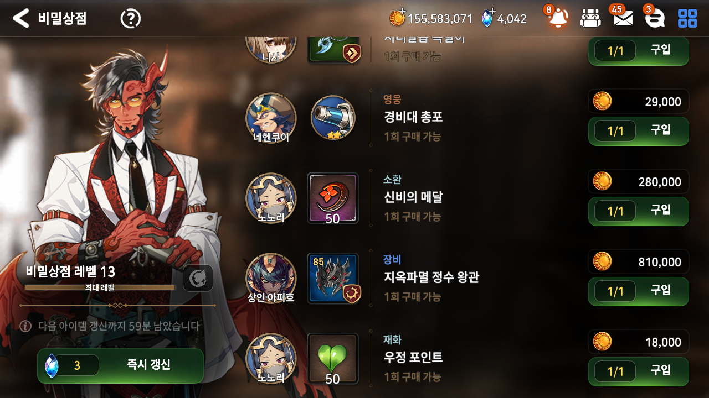
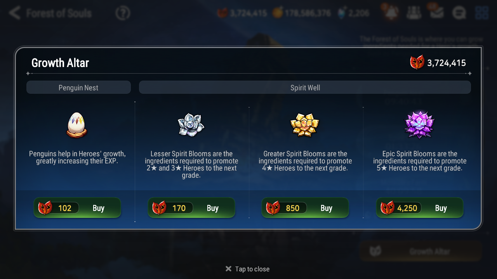
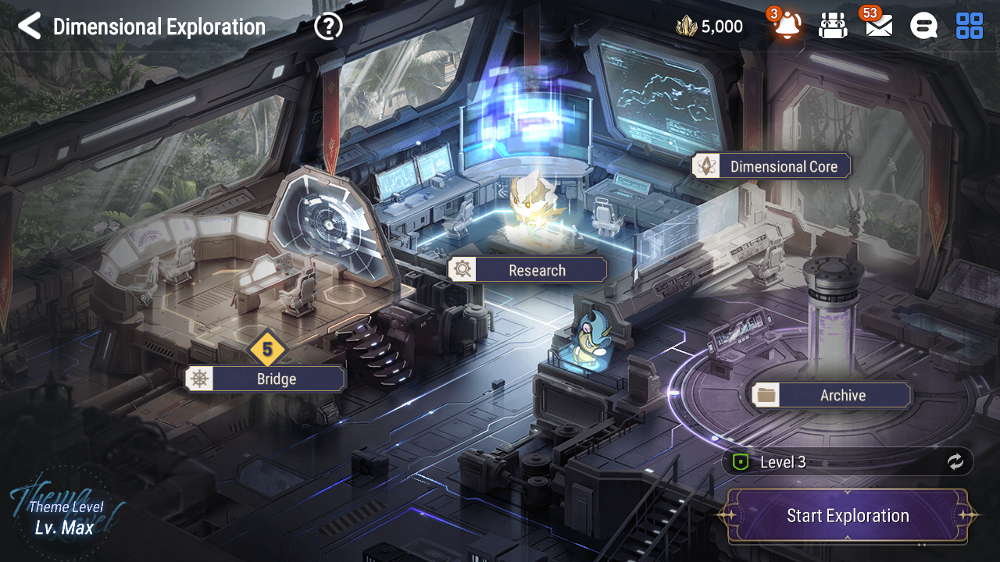
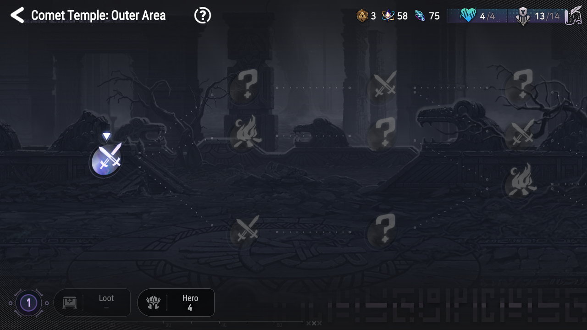

# EAB: an open-source Epic Seven tool for Secret Shop, Penguins, and Dimensional Exploration

Hi everyone! I'm working on **Epic7 Assist Bot (EAB)**, a Windows desktop tool for automating some of Epic Seven's repetitive tasks. The project was previously called SecretShopBot-E7, and I've been working on making it easier to use in English.

It works with the **STOVE PC client** or an **Android emulator through ADB**. The source is available on GitHub under GPLv3, and the packaged Windows download does not need a separate Python installation.

**[GitHub / source code](https://github.com/pelierze/EAB) · [Downloads](https://github.com/pelierze/EAB/releases/latest) · [Bug reports](https://github.com/pelierze/EAB/issues)**

## What it does

- **Secret Shop:** refreshes the shop and buys Covenant Bookmarks and Mystic Medals. Friendship Points are optional. You can set a refresh count or a Skystone budget.
- **Free Refresh Only:** checks the shop every 15 minutes without spending Skystones on refreshes. Purchases still cost their normal currency, and this mode keeps running until you stop it.
- **Penguins:** repeats Penguin Nest purchases using Stigma. Set the number of purchase cycles; each cycle is one purchase repetition, not one Penguin.
- **Dimensional Exploration:** handles recruitment, node movement, battles, and results, with hero choices and rank-up priorities. Available with English and Korean game screens in v1.7.0 and later.

## Where to start in the game

Open the matching screen yourself, then start the feature in EAB. These are the **in-game starting screens**, rather than screenshots of EAB's settings.

### 1. Secret Shop — start here

Leave the **shop item list open**, with the item purchase buttons and refresh button visible. Close any purchase or refresh confirmation popup first. The example screenshot is Korean; Secret Shop also supports English game screens.

In EAB, open **Secret Shop**, set **Refresh Count** or **Skystones to Use**, then click **Start**. Start with a small count while checking your setup. Refreshes spend Skystones, and Bookmark/Medal purchases spend Gold.

### 2. Penguins — start here

Open **Forest of Souls → Growth Altar** and leave this purchase list visible. The Penguin Nest is the leftmost item with the egg icon. Start from this list, before opening the quantity popup yourself.

In EAB, open **Penguins**, enter **Purchase Cycles**, then click **Start Penguin Run**. EAB selects the Penguin purchase, sets the maximum quantity when needed, and checks for **50/50** before buying. This spends Stigma.

### 3. Dimensional Exploration — starting screen

Choose your difficulty in the game and leave the hub open with **Start Exploration** visible at the lower right. EAB uses the difficulty you selected. Set your heroes, rank-up priorities, and target completed runs in EAB before starting.

For an existing run, the **node map** is also a supported starting point. English exploration is available in v1.7.0 and later. Use Pause to take a break, wait for pause confirmation, and return to the ongoing exploration screen before resuming.

Exploration event choices are selected randomly from eligible detected buttons. EAB does not read the choice descriptions or choose the best outcome, so unfavorable choices are possible.

## Quick setup

1. Download the **EAB release ZIP** from the link above, extract the entire folder, and run **EAB.exe**. Keep the accompanying files and `_internal` folder together.
2. Choose **English** from the app's **Language** menu.
3. Connect your game:
   - **STOVE:** select **STOVE PC Client**, click **Refresh Windows**, choose the Epic Seven window, and click **Connect**. In normal windowed mode, use **Resize to 1280×720** while the bot is stopped. Keep the game window open and not minimized.
   - **Emulator:** use **1280×720, DPI 240**, enable ADB debugging, then select **Emulator (ADB)**, **Scan Devices**, choose your device, and **Connect**.
4. Open the appropriate in-game screen shown above, configure the feature, and start with a small run count.

## Language support and current limits

The app interface can be switched between **English and Korean**. This does not change the game's language.

**Secret Shop and Penguin purchases support English and Korean game screens.** Some runtime logs and diagnostic messages may still appear in Korean.

**Dimensional Exploration supports English and Korean game screens in v1.7.0 and later.** It uses icons and screen layout rather than reading game text. Unrecognized screens can still cause the bot to stop; attach the entire error report folder when reporting a problem.

There are currently **no supported event runs** in the separate Event tab.

This is an unofficial automation tool. Check the game's terms before using it; I cannot guarantee account safety or protection from currency loss.

## Feedback

Feedback on the English wording and setup instructions would be especially helpful. If something stops or behaves unexpectedly, please [open an issue](https://github.com/pelierze/EAB/issues) with your EAB version, app/game language, STOVE or emulator details, and what happened. Include a screenshot and relevant logs if possible, after checking them for personal information.
