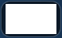

# 펭귄런의 언어 독립 인식

- 작업일: 2026-10-24
- 브랜치: `codex/i18n-penguin`
- 상태: 구현·영어 캡처 재현 검사 완료. 한국어/영어 실기 구매·반복 실행 확인 전.

## 사용한 최근 원본 4개

`images/raws/`의 최근 4개 파일을 모두 사용했다. 이 폴더는 Git·배포 대상에서 제외되어 있으므로 실행에 필요한 작은 템플릿은 `images/penguin/`으로 복사했다. 화면 재현 자료는 `tests/fixtures/penguin/english_shop_20261024.npz`에 보존했다.

| 원본 | 용도 |
|---|---|
| `epicseven 2026-10-24 01-12-19-27.png` | 1280×720 영어 펭귄 목록. 같은 상품 칸과 다른 상품·상단 잔액을 구분하는 검사 |
| `epicseven 2026-10-24 01-12-31-48.png` | 1280×720 영어 구매 팝업. MAX 외곽 추출·수량·구매 아이콘 검사 |
| `stigma.png` | 39×42 스티그마 아이콘. 목록과 팝업의 구매 버튼 대신 인식·클릭 |
| `+1.png` | 60×48 수량 증가 버튼. 오른쪽 MAX 박스의 기준점과 팝업 확인 |

## 실행 흐름

1. 기존 `egg.png`로 펭귄 알을 찾는다. 구매 탐색에 쓰는 다음 캡처에서도 알을 재확인해 팝업 뒤의 어두운 알이나 오래된 좌표를 거부한다.
2. 알 중심에서 좌우 145px, 알 아래 80~260px 안으로 스티그마 탐색을 제한한다. 기존 펭귄 열 범위 `x=42~344`도 적용한다. 상단 잔액과 다른 상품의 스티그마를 대신 누르지 않는다.
3. 찾은 스티그마 아이콘 중심을 클릭한다.
4. 구매 팝업은 `+1`과 하단 구매 영역의 스티그마가 함께 있어야 인정한다. 목록 화면의 스티그마만으로 팝업으로 판단하지 않는다.
5. `50/50`이면 MAX를 건너뛴다. 아니라면 `+1`의 오른쪽 인접 영역에서 검은 버튼 외곽을 찾아 중심을 클릭한다. 클릭할 좌표를 단순 오프셋으로 추측하지 않는다.
6. MAX 클릭 후 기존 팝업 확인 재시도 안에서 `50/50`을 확인한다. 수량이 바뀌지 않으면 최종 구매를 누르지 않는다.
7. 팝업 하단의 스티그마 중심을 클릭하고 기존 완료 팝업 화살표 인식을 사용한다.

영어 UI의 펭귄 탭을 활성화했다. UI 언어가 템플릿을 선택하지 않으며 한국어·영어에서 같은 인식 경로를 사용한다. 일반 로그 번역과 별도 게임 언어 설정은 후순위로 유지한다.

## 문자 제외 박스

`quantity_button.png`는 제공된 팝업의 `[x=869, y=449, width=78, height=48]`을 그대로 자른 원본이다. `template_masks.json`에서 내부 `[x=7, y=5, width=64, height=38]`을 제외한다. `Max` 글자를 포함한 넓은 중앙은 비교하지 않고 테두리·둥근 모서리·여백을 사용한다.

박스 외형만으로 다른 수량 버튼과 구분할 수 없으므로 먼저 `+1`을 찾은 다음 그 오른쪽 110px, 위아래 6px 여유 안에서만 비교한다. 왼쪽에 같은 박스가 있어도 MAX로 취급하지 않는다. 검토용 `masked/quantity_button.png`는 런타임 자산에 포함하지 않는다.

스티그마는 목록과 팝업의 미세한 크기 차이를 위해 0.95·1.0·1.05 배율로 비교한다. 구매 임계값은 기존 0.9를 유지한다. `egg.png`, `50check.png`, `close.png`는 변경하지 않았다. 기존 한국어 글자 전용 `buy_button.png`, `max_button.png`는 실행 코드와 배포 이미지 목록에서 제외했다.

마스크의 확대·축소는 색상과 알파를 같은 필터로 처리하고 완전히 불투명한 픽셀만 비교한다. 정상 흐름의 스크린샷·대기 횟수는 추가하지 않았다. MAX 수량이 불명확하면 기존 팝업 재확인 횟수 안에서 재시도한다.

## 검증 범위와 남은 확인

관련 자동 검사 119개가 통과했다. 펭귄 인식·사이클, UI·업데이트·창 크기 안내, 기존 비밀상점 마스크, 배포 자산·패키지 검사를 포함한다.

실제 영어 캡처에서 확인한 위치는 목록 스티그마 `(96,515,39,42)`, `+1` `(805,449,60,48)`, MAX `(869,449,78,48)`, 최종 구매 스티그마 `(596,570,37,40)`이다. 괄호는 `(x,y,width,height)`이다.

자동 검사에는 다음을 포함한다.

- 실제 영어 목록·팝업에서 알·스티그마·수량·수량 버튼 탐지.
- 구매·MAX 문자를 임의 픽셀로 바꿔도 같은 위치를 찾는지 확인.
- 다른 상품·상단 잔액의 아이콘, 팝업 뒤의 알, `+1` 누락, 오른쪽 박스 누락·왼쪽 동일 박스 거부.
- `50/50` 상태의 MAX 생략, MAX 선택 후 구매, 수량 변화 실패 시 최종 구매 차단을 캡처 순서로 재현.
- 공통 마스크 배율·ROI 좌표·빈 화면 검사, UI 번역·영어 펭귄 탭 활성화, 배포 자산 목록.

실제 게임에 연결해 재화를 사용하지 않았다. 완료 팝업 캡처는 제공되지 않아 기존 화살표를 합성 화면에 배치한 것으로 종료 흐름을 검사했다. 한국어 동일 화면 비교, 실제 완료 팝업·반복 실행·중지, 재화 부족과 화면 전환은 실기 확인이 필요하다. 캡처 재현 검사를 실기 구매 성공으로 간주하지 않는다.
